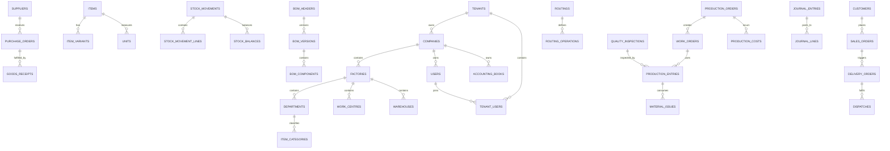

# Zoventra FactoryOS — Database ERD & Schema Catalogue

**Version 1.0** · 10 November 2026

This document is the complete database design reference for migrations. Each module owns its tables; cross-module relationships are explicit.

---

## 1. Key Database Design Rules

1. Use `tenant_id` on tenant-owned records.
2. Use `factory_id` where records are factory-specific.
3. Use `numeric`/`decimal` for financial values and quantities where precision matters; never floating-point for money.
4. Use foreign keys and appropriate database constraints.
5. Use immutable stock movement records.
6. Use transactions and row-level locking for critical stock operations.
7. Document number sequences safely under concurrent requests.
8. Store timestamps consistently; display in each company's configured timezone.
9. Add indexes based on actual query patterns.
10. Define data retention, archival and backup policies.

### Standard Tenant-Owned Table Columns

```
id              bigserial PRIMARY KEY
tenant_id       bigint NOT NULL (references tenants)
factory_id      bigint NULL    (references factories, where applicable)
created_at      timestamptz NOT NULL DEFAULT now()
updated_at      timestamptz NOT NULL DEFAULT now()
created_by      bigint NULL    (references users)
updated_by      bigint NULL    (references users)
```

Not every table needs every field (e.g., item category may be tenant-wide, not factory-specific).

---

## 2. Entity-Relationship Diagram (Mermaid)



---

## 3. Table Catalogue by Domain

### A. Platform & Tenancy

| Table | Description |
|---|---|
| `tenants` | Security & subscription boundary |
| `companies` | Legal company under a tenant |
| `company_settings` | Currency, tax, timezone, branding |
| `company_organisations` | Multi-entity organisation grouping |
| `factories` | Factory locations |
| `departments` | Factory departments |
| `shifts` | Shift definitions |
| `working_calendars` | Factory working days / holidays |
| `work_centres` | Production work centres |
| `warehouse_locations` | Racks and bins |
| `users` | Platform users |
| `tenant_users` | User-tenant association |
| `user_factory_access` | User factory-level access |
| `roles` | Spatie roles |
| `permissions` | Spatie permissions |
| `model_has_roles` | Role assignments |
| `model_has_permissions` | Permission assignments |
| `subscriptions` | Tenant subscriptions |
| `subscription_plans` | Plan definitions |
| `subscription_features` | Feature flags per plan |
| `tenant_licences` | Licence records (on-prem) |
| `audit_logs` | Immutable audit trail |

### B. Products & Configuration

| Table | Description |
|---|---|
| `item_categories` | Raw material, finished good, etc. |
| `items` | Item master / SKU |
| `item_variants` | Size, colour, material variants |
| `item_attributes` | Attribute definitions |
| `item_attribute_values` | Attribute values |
| `units` | Units of measurement |
| `unit_conversions` | Conversion rules |
| `product_barcodes` | Barcode/QR records |
| `product_documents` | Attached documents |
| `industry_templates` | Industry-specific templates |
| `industry_template_modules` | Template module mapping |
| `industry_template_settings` | Template settings |
| `custom_fields` | Extensible custom fields |
| `custom_field_values` | Custom field values |
| `number_sequences` | Document number sequences |

### C. Inventory

| Table | Description |
|---|---|
| `warehouses` | Warehouse definitions |
| `warehouse_bins` | Bin/location definitions |
| `stock_batches` | Batch/lot tracking |
| `stock_serial_numbers` | Serial number tracking |
| `stock_movements` | Authoritative stock movement header |
| `stock_movement_lines` | Stock movement line items |
| `stock_balances` | Controlled balance projection |
| `stock_reservations` | Stock reservations |
| `stock_adjustments` | Stock adjustments |
| `stock_counts` | Physical stock counts |
| `stock_count_lines` | Count line items |
| `stock_transfers` | Inter-warehouse transfers |
| `stock_transfer_lines` | Transfer line items |
| `stock_valuation_layers` | Valuation layers |
| `inventory_cost_layers` | Cost layers (FIFO/WA) |

### D. Purchasing

| Table | Description |
|---|---|
| `suppliers` | Supplier profiles |
| `supplier_contacts` | Contact persons |
| `supplier_items` | Supplier product catalogue |
| `purchase_requisitions` | Internal purchase requests |
| `purchase_requisition_lines` | Requisition line items |
| `supplier_quotations` | Supplier quotes |
| `supplier_quotation_lines` | Quote line items |
| `purchase_orders` | Purchase orders |
| `purchase_order_lines` | PO line items |
| `goods_receipts` | Goods Received Notes |
| `goods_receipt_lines` | GRN line items |
| `purchase_returns` | Returns to suppliers |
| `purchase_return_lines` | Return line items |
| `supplier_invoices` | Supplier bills |
| `supplier_invoice_lines` | Invoice line items |

### E. Manufacturing

| Table | Description |
|---|---|
| `bom_headers` | BOM master headers |
| `bom_versions` | BOM versions |
| `bom_components` | BOM components |
| `bom_alternatives` | Alternative materials |
| `bom_operations` | BOM operations |
| `routings` | Routing master |
| `routing_versions` | Routing versions |
| `routing_operations` | Routing operations |
| `operation_parameters` | Operation parameters |
| `production_plans` | Production plans |
| `production_plan_lines` | Plan line items |
| `production_orders` | Production orders |
| `production_order_lines` | Order line items |
| `work_orders` | Work orders |
| `work_order_operations` | Work order operations |
| `work_order_assignments` | Operator/machine assignments |
| `material_reservations` | Material reservations |
| `material_issues` | Material issues to production |
| `material_issue_lines` | Issue line items |
| `material_returns` | Material returns |
| `material_return_lines` | Return line items |
| `production_entries` | Production output entries |
| `production_entry_outputs` | Output records |
| `production_scrap` | Scrap records |
| `production_downtime` | Downtime records |
| `finished_goods_receipts` | Finished goods receipts |

### F. Quality

| Table | Description |
|---|---|
| `inspection_templates` | Inspection checklists |
| `inspection_template_items` | Template line items |
| `quality_inspections` | Inspection records |
| `quality_inspection_results` | Inspection results |
| `quality_defects` | Defect classifications |
| `quality_nonconformances` | Nonconformance records |
| `quality_rework_orders` | Rework orders |
| `quality_approvals` | Quality approvals |

### G. Costing

| Table | Description |
|---|---|
| `costing_methods` | Costing method definitions |
| `standard_costs` | Standard product costs |
| `standard_cost_components` | Cost component breakdown |
| `production_costs` | Actual production costs |
| `production_cost_lines` | Cost line items |
| `labour_costs` | Labour cost records |
| `machine_costs` | Machine cost records |
| `overhead_costs` | Overhead cost records |
| `cost_allocations` | Cost allocation records |
| `production_cost_variances` | Variance analysis |

### H. Sales & Dispatch

| Table | Description |
|---|---|
| `customers` | Customer profiles |
| `customer_contacts` | Contact persons |
| `sales_quotations` | Sales quotations |
| `sales_quotation_lines` | Quotation line items |
| `sales_orders` | Sales orders |
| `sales_order_lines` | Order line items |
| `sales_order_reservations` | Stock reservations for sales |
| `delivery_orders` | Delivery orders |
| `delivery_order_lines` | Delivery line items |
| `dispatches` | Dispatch records |
| `dispatch_lines` | Dispatch line items |
| `delivery_notes` | Delivery notes |
| `customer_returns` | Customer returns |
| `customer_return_lines` | Return line items |

### I. Accounting

| Table | Description |
|---|---|
| `accounting_books` | Accounting books (multi-book) |
| `financial_years` | Fiscal years |
| `accounting_periods` | Accounting periods |
| `chart_of_accounts` | COA definitions |
| `account_groups` | Account groupings |
| `journal_entries` | Journal entry headers |
| `journal_lines` | Journal entry lines |
| `accounting_dimensions` | Dimension definitions |
| `dimension_values` | Dimension values |
| `tax_codes` | Tax code definitions |
| `tax_rates` | Tax rate definitions |
| `tax_transactions` | Tax transaction records |
| `customer_invoices` | Customer invoices |
| `customer_invoice_lines` | Invoice line items |
| `supplier_bills` | Supplier bills |
| `supplier_bill_lines` | Bill line items |
| `customer_payments` | Customer receipts |
| `supplier_payments` | Supplier payments |
| `payment_allocations` | Payment allocations |
| `bank_accounts` | Bank account definitions |
| `bank_transactions` | Bank transactions |
| `bank_reconciliations` | Reconciliation records |
| `cash_accounts` | Cash account definitions |
| `fixed_assets` | Fixed asset register |
| `fixed_asset_depreciation` | Depreciation records |
| `recurring_journals` | Recurring journal templates |

### J. Maintenance & HR

| Table | Description |
|---|---|
| `machines` | Machine registry |
| `machine_categories` | Machine categories |
| `machine_meter_readings` | Meter readings |
| `maintenance_schedules` | Preventive schedules |
| `maintenance_orders` | Maintenance work orders |
| `maintenance_tasks` | Maintenance tasks |
| `machine_breakdowns` | Breakdown records |
| `machine_spare_parts` | Spare parts consumption |
| `employees` | Employee records |
| `employee_contracts` | Contract records |
| `employee_shifts` | Shift assignments |
| `attendance_records` | Attendance |
| `labour_entries` | Labour time entries |
| `overtime_records` | Overtime records |

### K. Platform Services

| Table | Description |
|---|---|
| `approval_workflows` | Workflow definitions |
| `approval_workflow_steps` | Workflow steps |
| `approval_requests` | Approval requests |
| `approval_actions` | Approval actions |
| `notifications` | Notification records |
| `notification_templates` | Template definitions |
| `attachments` | File attachments |
| `integration_connections` | External connections |
| `integration_logs` | Integration logs |
| `webhook_endpoints` | Webhook registrations |
| `webhook_deliveries` | Webhook delivery log |
| `api_tokens` | API token records |

---

## 4. Inventory Ledger Specification

`stock_movements` and `stock_movement_lines` are the authoritative stock history.

**stock_movements captures:**
- Tenant, Factory, Warehouse
- Item and variant
- Batch/lot or serial reference
- Movement type
- Quantity, Unit
- Source document, Source line
- Transaction date, Posting date
- Unit cost, Total cost
- User
- Reversal reference

`stock_balances` is a controlled performance projection — not the only source of truth.

**Inventory calculation:**
```
Available = OnHand - Reserved
```

Every stock change must create a traceable stock ledger entry. Posted movements cannot be silently edited or deleted.

---

## 5. Accounting Ledger Specification

`journal_entries` and `journal_lines` are the authoritative financial record.

**journal_entries contains:**
- Accounting book, Fiscal period
- Document date, Posting date
- Currency, Exchange rate
- Reference, Description
- Posting status, Reversal reference
- Source transaction
- Creator and approver

**Balancing rule:**
```
Σ Debits = Σ Credits
```

Journal lines support multiple currencies, base currency values and accounting dimensions.

**Posted journal rules:**
- Draft journals may be edited.
- Posted journals cannot be silently changed.
- Corrections use reversal and replacement.
- Closed periods cannot accept ordinary backdated postings.
- Every source document must have a traceable accounting reference.
- Debits and credits must balance before posting.
- Duplicate posting must be prevented.
- Currency exchange rates must be preserved at transaction time.

---

## 6. Indexing Strategy (Guidelines)

Primary indexes on all `id` columns. Foreign key indexes on all `tenant_id`, `factory_id`, `company_id`, `item_id`, `warehouse_id`, `supplier_id`, `customer_id`, `production_order_id`, `work_order_id`, `journal_entry_id`, `stock_movement_id` columns.

Composite indexes for common query patterns:
- `stock_movements(tenant_id, factory_id, warehouse_id, item_id, created_at)`
- `journal_lines(tenant_id, journal_entry_id, account_id)`
- `production_orders(tenant_id, factory_id, status, planned_date)`
- `stock_balances(tenant_id, factory_id, warehouse_id, item_id)`

---

## 7. Next Steps

1. Convert this catalogue into Laravel migrations.
2. Add model factories and seeders for each domain.
3. Define tenant-aware global scopes on all tenant-owned models.
4. Implement row-level locking for stock posting operations.
5. Set up PostgreSQL row-level security policies as defence in depth.